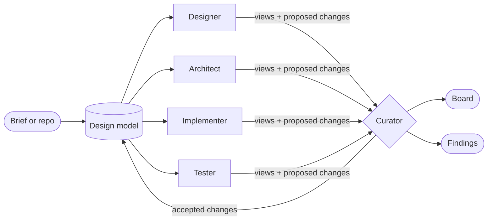

# Atelier

**A studio of AI perspectives that draw your software.**

Give Atelier a brief, or a repository and a question. Four perspectives, a designer, an architect, an implementer and a tester, each draw the system from their own point of view. They use a local Python drawing kit, look at what they drew, and revise it. A curator lines their views up against one shared design model and reports where they disagree.

Those disagreements are the point. An error screen with no path in the architecture, a dependency that would need a cycle in code, a state change that no test covers: each one is easy to miss in a single diagram and hard to miss when four views sit side by side.

> **Status: early.** The concept, the perspectives and the development process are in place. The drawing kit is next. Nothing runs yet. Follow along in the [epics](https://github.com/mjohnson139/atelier/issues?q=is%3Aissue+label%3Aepic).

## How a session works

1. **Frame.** The curator turns the brief into a design model: actors, components, flows, states, risks.
2. **Draw.** The four perspectives work in parallel. Each writes a spec, renders it, looks at the image, scores it against a rubric, and revises. Three passes at most.
3. **Propose.** Perspectives never edit the model. They return their views and a list of proposed changes, each with a reason.
4. **Cross-examine.** The curator compares the views with the model and with each other.
5. **Hang the board.** One page with every view, the findings, and draft issues for the ones worth doing.

## The studio

| Perspective | Sees | Draws |
|---|---|---|
| **Designer** | the person using it | flow maps, wireframes, a state grid per screen, journeys |
| **Architect** | boundaries, data and failure | C4 diagrams, sequences with failure branches, trust zones, deployment |
| **Implementer** | modules, types and build order | dependency graphs from real code, contract cards, call graphs |
| **Tester** | where it will break | state machines with test coverage, risk heatmaps, boundary grids |
| **Curator** | all of it | runs the session, owns the model, compares the views |

Each perspective is a Claude Code agent file in [`.claude/agents/`](.claude/agents/), with a point of view, a list of things it ignores, its favourite forms and a rubric for judging its own drawings.

## The drawing kit

`atelier_kit` is a small Python package served to the perspectives as a local MCP server. Tools take a JSON spec and return SVG and PNG: `draw_graph`, `draw_sequence`, `draw_wireframe`, `draw_state_machine`, `draw_heatmap`, `scan_repo`, a sandboxed free-hand `sketch` canvas, `look` (which hands the image back to the model) and `compose_board`.

All rendering is local and deterministic. No spec or image is sent to a hosted renderer, and every image is committed next to the spec that made it, so a drawing can be re-rendered and compared in review.

## Where it runs

1. **Inside Claude Code** (first): agents, the MCP server and an `/atelier` skill. No infrastructure.
2. **A headless CLI** on the Claude API, plus a GitHub Action that redraws the board when a pull request changes the architecture.

## How it is built

Atelier is developed by AI agents under one owner, with a process carried over from [Words & Waffles](https://github.com/mjohnson139/words-and-waffles): GitHub issues are the queue, each session takes one issue to a reviewed pull request, a strong model plans and reviews while cheaper models do well-specified units, and lessons go into [`docs/solutions/`](docs/solutions/). The owner merges.

- [`docs/concept.md`](docs/concept.md): the full concept
- [`AGENTS.md`](AGENTS.md) and [`.github/dev-process.md`](.github/dev-process.md): how work gets done
- [`docs/decisions.md`](docs/decisions.md): product decisions and the defaults in force
- [`CONTRIBUTING.md`](CONTRIBUTING.md): how to help

## Licence

[MIT](LICENSE)
