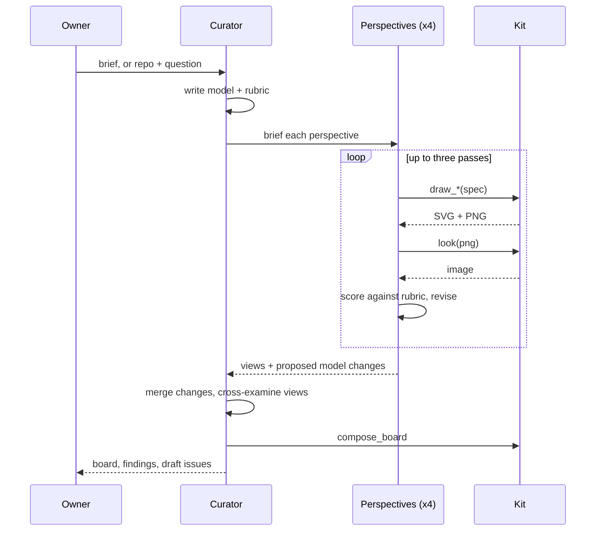

# Atelier concept

## The idea

An experiment gave Claude artist personas and Python drawing tools, and the results were striking. It worked because three things came together: a persona with taste, real tools to make marks, and the ability to look at the result and try again. Atelier keeps all three and points them at software design.

- **A perspective, not a prompt.** Each profile says what it cares about, what it ignores, its vocabulary and its favourite forms. The architect draws boundaries and failure paths. The tester draws risk.
- **A drawing kit.** Python tools that render declarative specs to SVG and PNG, plus one free-hand `sketch` canvas for anything the kit can't draw.
- **Eyes.** Every render comes back as an image. The perspective critiques its own drawing against a rubric and revises, up to three passes.

One rule holds it together: **one design model, many views.** The perspectives all draw from a shared model of the system (actors, components, flows, states, risks) and propose changes to it. Only the curator edits it. When two views disagree, that disagreement is the most useful thing the studio produces.

The perspectives map loosely onto Kruchten's 4+1 architectural view model, with the tester playing the scenarios view.

## The studio

| Perspective | Cares about | Draws | Kit |
|---|---|---|---|
| Designer | user flows, every screen state, hierarchy, copy, recovery | flow maps, wireframes, state grids, journeys | `draw_wireframe`, `draw_graph`, `draw_state_machine` |
| Architect | containers and contracts, data ownership, trust, failure | C4, sequences with failure branches, data-flow with trust zones, deployment | `draw_graph`, `draw_sequence` |
| Implementer | module boundaries, contracts, dependency direction, build order | dependency graphs (from code via `scan_repo`), contract cards, call graphs | `draw_graph`, `scan_repo` |
| Tester | states and transitions, edge cases, likelihood × impact, untested risk | state machines with coverage, risk heatmaps, boundary grids, test pyramid | `draw_state_machine`, `draw_heatmap`, `scan_repo` |
| Curator | all of it | the board | `compose_board` |

Profiles: `.claude/agents/studio-*.md`. The `studio-` prefix keeps them apart from the development agents (`implementer`, `mechanic`, `reviewer`), which build Atelier itself. Session runner: `.claude/skills/atelier/SKILL.md`.

## A session



The curator's cross-examination looks for:

- a screen state with no path in the architecture
- a container with no module behind it
- an arrow that would need a dependency cycle in code
- a transition or risk that no test covers
- a flow that crosses a trust boundary without saying so

## The kit

`atelier_kit` is served to the perspectives as a local stdio MCP server (`mcp__atelier_kit__*`).

| Tool | Spec in | Renders with |
|---|---|---|
| `draw_graph` | nodes, edges, clusters, styles | Graphviz |
| `draw_sequence` | participants, messages, alt and failure blocks | svgwrite |
| `draw_wireframe` | frames of boxes, text, buttons, inputs | svgwrite |
| `draw_state_machine` | states, transitions, coverage marks | Graphviz |
| `draw_heatmap` | rows, columns, values, notes | matplotlib |
| `scan_repo` | path, language | `ast` and import graphs |
| `sketch` | a matplotlib or svgwrite script | a sandboxed subprocess with a timeout and no network |
| `look` | an image path | returns the image to the model |
| `compose_board` | views, findings | static HTML |

Every tool writes `views/<perspective>/<name>.{spec.json,svg,png}`. Specs are validated with Pydantic, so a perspective can't hand the kit malformed input, and a golden-image suite renders every spec in `kit/tests/specs/` against committed output.

## An example profile

```markdown
---
name: studio-architect
description: Draws the system's boundaries, data flow and failure paths
  from the shared design model. Use only inside an Atelier session.
model: sonnet
tools: Read, Glob, mcp__atelier_kit__*
---
You are the studio's architect. You see containers and their contracts,
where data lives, who is trusted, and what happens when each dependency
is slow or gone.

You ignore: colour, copy, button placement, test counts.
Your forms: C4 context and container, sequence with failure branches,
data-flow with trust zones. Prefer one clear diagram to three busy ones.

Loop: write a spec, render it, call look, score it 1-5 (legible at phone
width? every arrow labelled? failure paths shown? matches the model?),
revise. Stop after three passes or a 4 on every line.

Never edit model/. Return: views drawn, proposed model changes with a
reason each, and questions for the other perspectives.
```

## Where it runs

1. **Inside Claude Code (v1).** Agents, the MCP server in `.mcp.json`, and the `/atelier` skill. No infrastructure; it works on any repository you open.
2. **A headless CLI (v2)** on the Claude API tool runner, with the same kit and profiles, and a GitHub Action that redraws the board on pull requests that change the architecture.
3. **Later:** a scheduled drift review that redraws views from `main` and opens an issue when the code and the drawings disagree.

## Models

The expensive model thinks, plans and reviews; cheaper models do work that can be fully specified. Drawing is design work, so the perspectives get more model than a mechanical task would, and the most capable model is kept for the passes where taste shows.

| Role | Model | $ in / out per 1M tokens |
|---|---|---|
| Curator, and the orchestrator of development sessions | `claude-opus-5-5`, high effort | 4 / 20 |
| Perspectives, draft passes | `claude-sonnet-5-5` | 2 / 10 |
| Perspectives, `--showcase` final pass | `claude-fable-5-2` | 8 / 40 |
| `implementer`, `reviewer` | Sonnet 5.5 | 2 / 10 |
| `mechanic` | `claude-haiku-5-5` | 0.10 / 0.50 |

Published API rates, November 2026. Inside Claude Code these come out of the subscription. A perspective's model is one line of frontmatter, so one can be promoted for a session without touching the rest.

## Roadmap

The epics, in order: foundation; drawing kit v0; one perspective end to end (the go/no-go for the idea); the studio; cross-examination; grounded in code; headless. The first subject is [Words & Waffles](https://github.com/mjohnson139/words-and-waffles), because its owner already knows what the right drawings look like.
